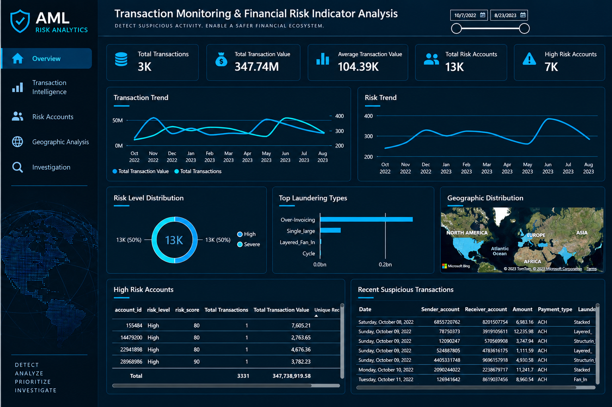
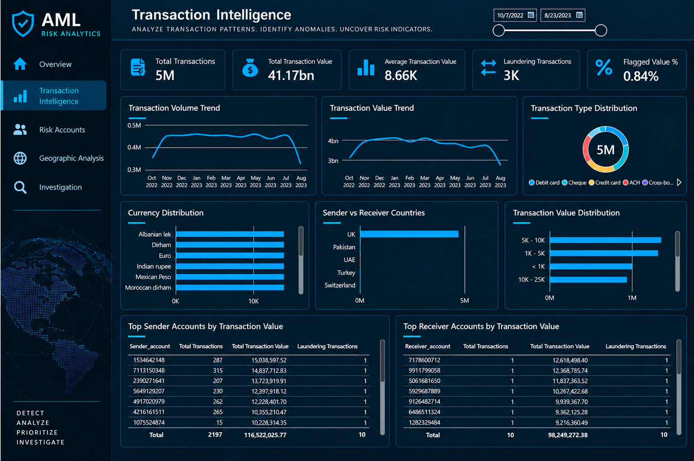
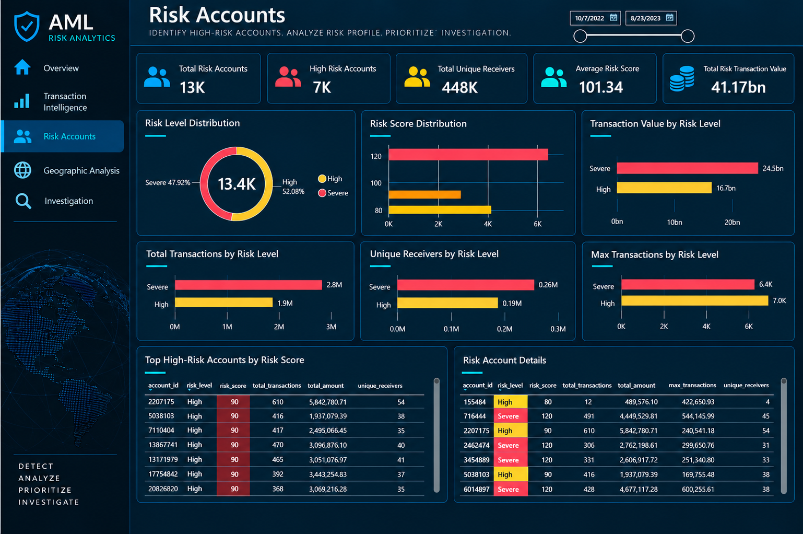
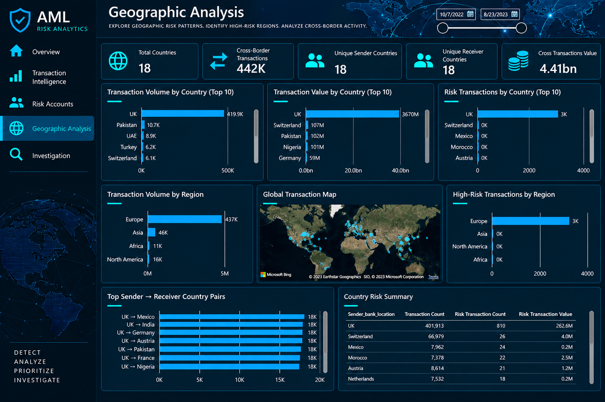
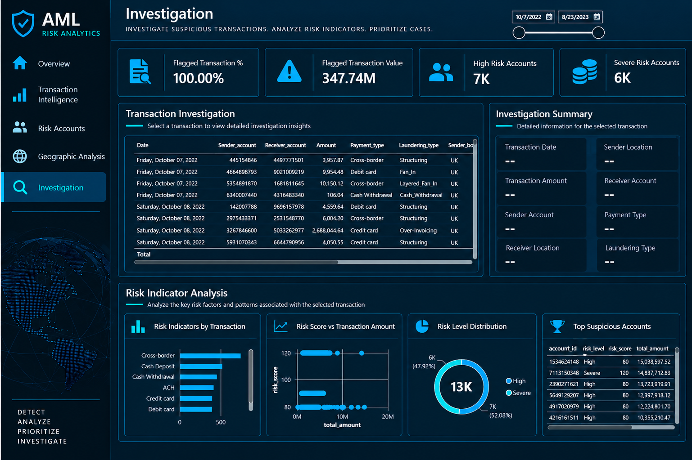

# Transaction Monitoring & Financial Risk Indicator Analysis

An AML-style (Anti-Money Laundering) transaction monitoring system that identifies suspicious financial behavior, prioritizes high-risk accounts, and supports investigator decision-making using rule-based risk scoring and an interactive multi-page Power BI dashboard.

---

## Table of Contents
- [Problem Statement](#problem-statement)
- [Dataset](#dataset)
- [Architecture / Data Flow](#architecture--data-flow)
- [Methodology](#methodology)
- [Dashboard](#dashboard)
- [Key Findings](#key-findings)
- [Business Recommendations](#business-recommendations)
- [How to Reproduce](#how-to-reproduce)
- [Limitations & Future Work](#limitations--future-work)
- [Tools & Technologies](#tools--technologies)
- [Data Source & Licensing](#data-source--licensing)

---

## Problem Statement

Financial institutions must flag suspicious transaction patterns for regulatory compliance (AML/KYC). Manually reviewing millions of transactions is infeasible — this project simulates a **rule-based triage workflow** that ranks accounts for further review. In the current output, flagged accounts are associated with approximately **50.0% of all transactions**, so the rules should be treated as an initial prioritization prototype rather than evidence that the review queue is small or efficient. The fraction of distinct sender accounts flagged and precision/recall against the dataset's ground-truth label have not yet been calculated.

---

## Dataset

This project uses **SAML-D**, a published synthetic anti-money-laundering benchmark dataset (Oztas et al.), containing **9,504,852 transactions** across 12 features, including sender/receiver account IDs, amount, payment type, and sender/receiver bank locations. The dashboard currently displays a date range of **October 2022 to August 2023**; this range should be interpreted as the range shown in the report, not evidence that every month has equal coverage. SAML-D is synthetic benchmark data, not real bank activity, so patterns observed here must not be generalized directly to real financial institutions or real-world laundering prevalence.

> **Label and validation caveat:** SAML-D includes a ground-truth `Is_laundering` field. The SQL scoring rules in this repository do **not** use that field and have not been evaluated against it. The source and derivation of the typology labels currently displayed in the Power BI report have not been independently verified; therefore, those labels must not be presented as typologies detected by this SQL rule engine. See [Limitations](#limitations--future-work).

---

## Architecture / Data Flow

```
SAML-D Transaction Data (saml_d_raw)
        │
        ▼
SQL (SQLite) — Rule-based Risk Scoring (risk_rules.sql)
        │
        ▼
customer_risk_categorized — Account-level Risk Tiers
        │
        ▼
dashboard_cases.csv — Published account-level case output (~13,424 flagged accounts)
        │
        ▼
[dashboard_transactions — intended transaction-level detail; not included]
        │
        ▼
Power BI — 5-page report (editable .pbix available in the GitHub release)
(Overview · Transaction Intelligence · Risk Accounts · Geographic Analysis · Investigation)
```

`dashboard_cases` contains one row per flagged **sender account** (risk score, tier, transaction count/value, maximum single-transaction amount, and unique receiver count). `dashboard_transactions` contains individual transactions sent by High/Severe accounts. The raw SAML-D dataset is not included, so users must obtain it separately and load it into SQLite before running the SQL. The screenshots below are static previews. The editable Power BI report is available as a downloadable release asset: [Download the AML Power BI report (.pbix)](https://github.com/pranjali-sonkamble/Transaction-Monitoring-Financial-Risk-Analysis/releases/download/v1.0.0/AML_Transaction_Monitoring_Risk_Analytics.pbix).

> **Reproducibility note:** `risk_rules.sql` builds the account-level `dashboard_cases` table and transaction-level `dashboard_transactions` table from `saml_d_raw`. Export `dashboard_cases` to CSV separately using SQLite's CSV output mode. The published `dashboard_cases.csv` is a snapshot, not a substitute for the raw input data.

---

## Methodology

### Risk Scoring Logic

Each account starts at a risk score of 0. Points are added based on three independent rule checks against that account's transaction history:

| Rule | Condition | Points |
|------|-----------|--------|
| High-value transaction | Any transaction > $100,000 | +50 |
| Very high-value transaction | Any transaction > $250,000 | +30 |
| High activity | More than 300 total transactions sent | +40 |

### Risk Tiers

| Tier | Score | How it's triggered | Accounts | % |
|------|-------|--------------------|----------|---|
| **Severe** | 120 | All three rules triggered (>$100K **and** >$250K **and** >300 txns) | 6,433 | 47.9% |
| **High** | 90 | >$100K and >300 txns, but no transaction over $250K | 2,909 | — |
| **High** | 80 | >$100K and >$250K, but ≤300 txns | 4,082 | — |
| High (combined) | 80–90 | — | 6,991 | 52.1% |
| Medium / Low | <80 | One or zero rules triggered | *(excluded from dashboard — see note below)* | — |

> Only accounts scoring 80+ (High/Severe) were carried into the dashboard; Medium/Low-risk accounts were scored but not surfaced for manual review, keeping the investigation queue focused.

This is a deliberately simple, additive rule model rather than a weighted/ML-based one — the tradeoff is interpretability and regulatory explainability (a compliance officer can see exactly *why* an account was flagged) at the cost of missing more subtle multi-factor patterns an anomaly-detection model might catch.

### Laundering-Type Classification

The Power BI report displays a smaller typology-tagged transaction subset (approximately 3K transactions, according to the current dashboard). However, the tagging logic and provenance have not been verified against the SQL in this repository. These labels are therefore **dashboard classifications of unverified provenance**, not confirmed detections produced by the risk-scoring SQL. Do not interpret the tagged subset as a measured precision or as independently confirmed laundering.

---

## Dashboard

A 5-page interactive Power BI report, moving from portfolio-level triage down to single-transaction investigation:

> **Dashboard validation caveat:** The Overview page's risk-account and transaction KPIs, donut labels, and the relationship between account-level risk scores and typology-tagged transaction rows have not yet been reconciled against the underlying model measures. Treat those visuals as a presentation preview until the measures and filter context are checked in Power BI Desktop. The SQL-derived account score is calculated from the full sender-account transaction history; a visual showing only a tagged transaction subset must not imply that the displayed subset alone generated the account's score.

### Overview
Portfolio-level entry point: total risk accounts, high-risk accounts, transaction/risk trend over time, risk-level distribution, top laundering types, geographic distribution, and a table of recent suspicious transactions.


### Transaction Intelligence
Full transaction-level view across the flagged accounts' activity: volume and value trend, currency distribution, sender/receiver country breakdown, transaction value distribution, and top sender/receiver accounts by value.


### Risk Accounts
Account-level risk profile: risk level and score distribution, transaction value/count by risk level, unique receivers by risk level, and a ranked table of top high-risk accounts by score.


### Geographic Analysis
Cross-border and regional view: transaction volume/value by country, high-risk transactions by country, top sender→receiver country pairs, and a quantified country risk summary table.


### Investigation
Case-level drill-through: a filterable transaction investigation table, an investigation summary panel (populates on row selection), risk indicators by transaction, risk score vs. transaction amount, risk level distribution, and a top suspicious accounts leaderboard.


---

## Key Findings

- **13,424 accounts** were classified as High or Severe risk in the published account-level output, representing **$41.17B** in flagged transaction value — split between **Severe (47.9%)** and **High (52.1%)**. These are rule-triggered risk indicators, not confirmed laundering cases.
- The Severe tier has **6,433 accounts**. Based on the current audit, its median is **429 transactions** and **40 unique receivers**; only **6 accounts** have 700 or more transactions. One top account sent 743 transactions to 58 distinct receivers totaling $5.05M. This is an example of a high-activity account, not a representative profile for every Severe account.
- A case-level drill-through surfaced a concrete structuring pattern: one account made **11 cross-border transfers to the same receiver within a single day**, each individually in the $20K–21K range — well under any single-transaction alert threshold, but cumulatively over $230K in a day. This is exactly the kind of activity a pure "amount > $100K" rule would miss, which is why the frequency-based rule (+40 for >300 transactions) matters as a complementary signal.
- Geographic analysis is now quantified: the **UK** leads both in transaction volume and in the number of flagged/risk transactions, while **Switzerland** shows the highest cross-border transaction *value* among non-UK countries. The most active cross-border corridors are UK→Mexico, UK→India, and UK→Germany.
- The dashboard's transaction-value trend appears relatively steady over the displayed period. Because SAML-D is synthetic, this may reflect assumptions in the data-generation process and should not be interpreted as evidence that real-world suspicious activity behaves routinely.
- The dashboard displays a typology-tagged subset, but the provenance of those tags has not been verified. The share of this subset is not a validated measure of laundering detection quality.

## Business Recommendations

- Prioritize the ~6,400 accounts scoring **120 (Severe)** for manual investigation first — they account for the majority of flagged value and show the clearest multi-signal fingerprint (high value + high frequency + wide fan-out).
- Use the UK→Mexico, UK→India, and UK→Germany corridors as a starting point for cross-referencing receiver-country risk ratings, since these carry the highest flagged cross-border volume.
- Treat the structuring pattern (many similar-sized transactions to one receiver in a short window) as its own explicit rule going forward, rather than relying on the frequency rule to catch it indirectly.

---

## How to Reproduce

1. Download the SAML-D dataset (published by Oztas et al.; see the Kaggle link below) and import the transaction file into a SQLite database table named `saml_d_raw`. Confirm that the imported columns include `Sender_account`, `Receiver_account`, `Amount`, `Date`, `Time`, `Payment_type`, `Sender_bank_location`, and `Receiver_bank_location`.
2. Run the SQL script from the directory containing your database: `sqlite3 saml_d.db < risk_rules.sql`. The script drops and rebuilds its derived tables, so use a working copy of your database if you need to preserve existing outputs.
3. Export the account-level output to CSV: `sqlite3 -header -csv saml_d.db "SELECT * FROM dashboard_cases;" > dashboard_cases.csv`. The script also creates `dashboard_transactions` for the flagged accounts.
4. Run the local validation queries with `sqlite3 -header -column saml_d.db < audit_validation.sql`. This reports distinct sender-account flag coverage, source-label encoding, transaction-row precision/recall/specificity against `Is_laundering`, date bounds, and derived-table row counts. The evaluation labels are used only for measurement, not for rule scoring. Check the label-distribution output first; if the source uses values other than `1/0`, `true/false`, or `yes/no`, adjust the mapping in `audit_validation.sql` before interpreting precision/recall. These metrics have not been run against the full local dataset yet, so do not quote results until you execute and review them.
5. The five dashboard screenshots are static previews. Download the editable Power BI (`.pbix`) report from the [v1.0.0 GitHub release](https://github.com/pranjali-sonkamble/Transaction-Monitoring-Financial-Risk-Analysis/releases/download/v1.0.0/AML_Transaction_Monitoring_Risk_Analytics.pbix). The report's typology-label provenance and exact data-refresh inputs are not yet verified; refreshing it may require rebuilding the relevant Power BI model.

*(The raw SAML-D dataset is not included due to size. The repository provides `risk_rules.sql`, `dashboard_cases.csv`, and static dashboard screenshots.)*

---

## Limitations & Future Work

- **Initial local ground-truth validation (SQLite, 9,504,852 rows).** The user's local audit run found 292,715 distinct sender accounts, of which 13,424 were classified High/Severe (**4.59%**). Those accounts' transactions numbered 4,756,064 (**50.04%** of all rows). At transaction-row level, mapping each sender account's High/Severe tier to each of its transactions and comparing it with `Is_laundering` yielded **3,331 true positives, 4,752,733 false positives, 6,542 false negatives, and 4,742,246 true negatives**: precision **0.0700%**, recall **33.74%**, and specificity **49.94%**. The source had 9,873 positive-label rows and no null labels. These are transaction-row metrics for this particular account-level heuristic, not account-level precision/recall; the very low precision and high alert volume mean the current rules are not a validated or efficient review queue. The sender-account share was calculated from the known account totals because the first local audit run's account-share query errored due to a stale script version; the repository version of `audit_validation.sql` uses `account_id` for the derived table.
- **Typology provenance is unverified.** The SQL script does not implement Structuring, Fan-In, Layered Fan-In, Over-Invoicing, Cycle, or other typology classifiers. The Power BI report displays such labels, but the source field and transformation that populate them have not been verified. They may reflect dataset-provided labels or a separate transformation; until traced, they must not be claimed as detections produced by this project.
- **Synthetic-data generalization.** Geographic concentration (including UK dominance) and apparently routine account behavior may be characteristics of SAML-D's generator. These are descriptive observations in this synthetic benchmark, not evidence of real-world geographic or behavioral patterns.
- **No entity-resolution or network view.** Accounts are scored independently; a graph-based approach (shared receivers, device/IP overlap where available) would catch coordinated multi-account laundering rings that this account-by-account scoring misses.
- **Static, batch-scored.** Everything here is computed once over the full dataset; a production system would need incremental/near-real-time scoring as new transactions arrive.
- **Full raw data and transaction-level table generation are not included.** The editable Power BI report is available in the [GitHub release](https://github.com/pranjali-sonkamble/Transaction-Monitoring-Financial-Risk-Analysis/releases/tag/v1.0.0), but refreshing it may require reconstructing the missing transaction-level input; that generation process remains undocumented.

---

## Tools & Technologies

- **SQL (SQLite)** — data ingestion, rule-based risk scoring, tiering logic
- **Power BI** — 5-page interactive report (Overview, Transaction Intelligence, Risk Accounts, Geographic Analysis, Investigation), drill-through investigation view
- **Dataset:** SAML-D synthetic AML benchmark (Oztas et al.)

---

## Data Source & Licensing

**Dataset:** SAML-D, a synthetic anti-money-laundering transaction dataset. All accounts and transactions are simulated; no real customer data is used.

- Oztas, B., Cetinkaya, D., Adedoyin, F., Budka, M., Dogan, H. and Aksu, G. (2023). *Enhancing Anti-Money Laundering: Development of a Synthetic Transaction Monitoring Dataset.* 2023 IEEE International Conference on e-Business Engineering (ICEBE), pp. 47-54. DOI: [10.1109/ICEBE59045.2023.00028](https://doi.org/10.1109/ICEBE59045.2023.00028)
- Dataset page: [Kaggle, Synthetic Transaction Monitoring Dataset (AML)](https://www.kaggle.com/datasets/berkanoztas/synthetic-transaction-monitoring-dataset-aml)

The raw dataset is not redistributed here. `dashboard_cases.csv` and the dashboard screenshots are derived from it. They remain subject to the dataset owners' terms; check the Kaggle page for the current terms before reusing them.

**Code license:** The SQL, documentation and original work in this repository are released under the [MIT License](LICENSE). The MIT License does not apply to the SAML-D data.

This project is an independent portfolio exercise and is not affiliated with or endorsed by the dataset authors.

## Author

Pranjali Sonkamble
