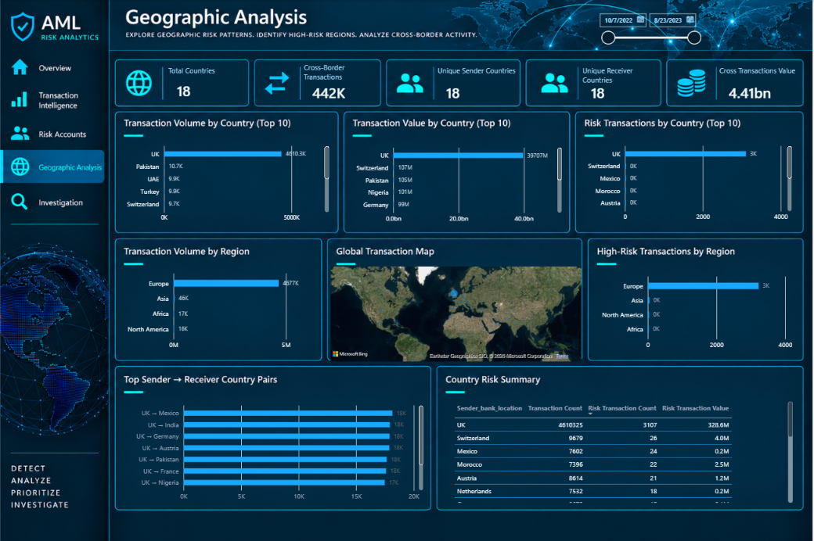
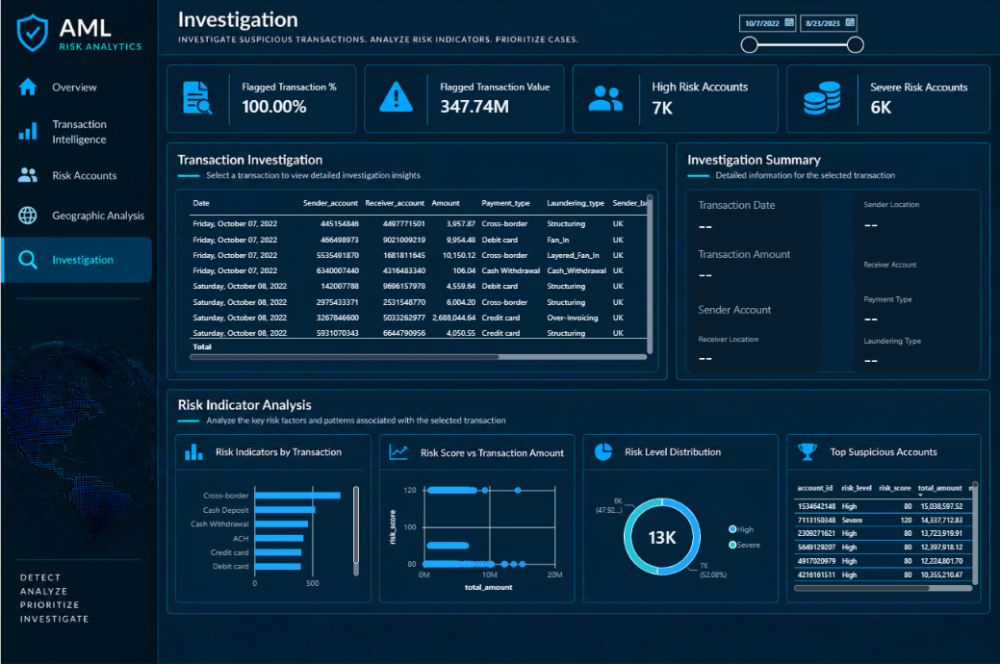

# Transaction Monitoring & Financial Risk Indicator Analysis

An AML-style (Anti-Money Laundering) transaction monitoring system that identifies suspicious financial behavior, prioritizes high-risk accounts, and supports investigator decision-making using rule-based risk scoring and an interactive multi-page Power BI dashboard.

---

## Table of Contents
- [Problem Statement](#problem-statement)
- [Dataset](#dataset)
- [Architecture / Data Flow](#architecture--data-flow)
- [Methodology](#methodology)
- [Dashboard](#dashboard)
- [Key Findings](#key-findings)
- [Business Recommendations](#business-recommendations)
- [How to Reproduce](#how-to-reproduce)
- [Limitations & Future Work](#limitations--future-work)
- [Tools & Technologies](#tools--technologies)
- [Data Source & Licensing](#data-source--licensing)

---

## Problem Statement

Financial institutions must flag suspicious transaction patterns for regulatory compliance (AML/KYC). Manually reviewing millions of transactions is infeasible — this project simulates how a financial crime/compliance team would build a **rule-based monitoring system** to surface the highest-risk accounts from a large transaction dataset, replacing "review everything" with "review what matters first."

---

## Dataset

This project uses **SAML-D**, a published synthetic anti-money laundering benchmark dataset (Oztas et al.), containing **9,504,852 transactions** across 12 features, including sender/receiver account IDs, amount, payment type, and sender/receiver bank locations. The dataset spans transactions from **November 2022 to July 2023**. It was chosen because it's purpose-built for AML research — it models realistic laundering typologies (structuring, fan-out, cross-border layering) rather than generic transaction noise, and unlike real bank data, it can be shared and analyzed without privacy/regulatory restrictions.

> Note: SAML-D also ships with a ground-truth `Is_laundering` label. This project's rule-based scores were **not** validated against that label — see [Limitations](#limitations--future-work).

---

## Architecture / Data Flow

```
SAML-D Transaction Data (saml_d_raw)
        │
        ▼
SQL (SQLite) — Rule-based Risk Scoring (risk_rules.sql)
        │
        ▼
customer_risk_categorized — Account-level Risk Tiers
        │
        ▼
dashboard_cases.csv — Published account-level case output (~13,424 flagged accounts)
        │
        ▼
[dashboard_transactions — intended transaction-level detail; not included]
        │
        ▼
Power BI — 5-page report (editable .pbix available in the GitHub release)
(Overview · Transaction Intelligence · Risk Accounts · Geographic Analysis · Investigation)
```

The intended dashboard design uses two grains: `dashboard_cases` holds one row per flagged **account** (risk score, tier, transaction/receiver counts), while `dashboard_transactions` is intended to hold individual transactions for those accounts. The transaction-level table is not included in this repository, so that part of the data flow cannot currently be reproduced from the published files alone. The screenshots below are static previews. The editable Power BI report is available as a downloadable release asset: [Download the AML Power BI report (.pbix)](https://github.com/pranjali-sonkamble/Transaction-Monitoring-Financial-Risk-Analysis/releases/download/v1.0.0/AML_Transaction_Monitoring_Risk_Analytics.pbix).

> **Reproducibility note:** `dashboard_cases.csv` is produced by `risk_rules.sql`. The generation process for the intended transaction-level `dashboard_transactions` table has not been verified, so it is not documented as a reproducible step.

---

## Methodology

### Risk Scoring Logic

Each account starts at a risk score of 0. Points are added based on three independent rule checks against that account's transaction history:

| Rule | Condition | Points |
|------|-----------|--------|
| High-value transaction | Any transaction > $100,000 | +50 |
| Very high-value transaction | Any transaction > $250,000 | +30 |
| High activity | More than 300 total transactions sent | +40 |

### Risk Tiers

| Tier | Score | How it's triggered | Accounts | % |
|------|-------|--------------------|----------|---|
| **Severe** | 120 | All three rules triggered (>$100K **and** >$250K **and** >300 txns) | 6,433 | 47.9% |
| **High** | 90 | >$100K and >300 txns, but no transaction over $250K | 2,909 | — |
| **High** | 80 | >$100K and >$250K, but ≤300 txns | 4,082 | — |
| High (combined) | 80–90 | — | 6,991 | 52.1% |
| Medium / Low | <80 | One or zero rules triggered | *(excluded from dashboard — see note below)* | — |

> Only accounts scoring 80+ (High/Severe) were carried into the dashboard; Medium/Low-risk accounts were scored but not surfaced for manual review, keeping the investigation queue focused.

This is a deliberately simple, additive rule model rather than a weighted/ML-based one — the tradeoff is interpretability and regulatory explainability (a compliance officer can see exactly *why* an account was flagged) at the cost of missing more subtle multi-factor patterns an anomaly-detection model might catch.

### Laundering-Type Classification

Within the flagged accounts' transaction history, a subset of transactions is further tagged with a specific laundering typology — e.g. Structuring, Fan-In, Layered Fan-In, Cash Withdrawal, Over-Invoicing, Cycle. This subset (≈3K transactions, ~$347.74M, **0.84%** of flagged transaction value) represents the highest-confidence, pattern-matched cases and is what the Overview and Investigation pages surface as the primary case queue.

---

## Dashboard

A 5-page interactive Power BI report, moving from portfolio-level triage down to single-transaction investigation:

### Overview
Portfolio-level entry point: total risk accounts, high-risk accounts, transaction/risk trend over time, risk-level distribution, top laundering types, geographic distribution, and a table of recent suspicious transactions.


### Transaction Intelligence
Full transaction-level view across the flagged accounts' activity: volume and value trend, currency distribution, sender/receiver country breakdown, transaction value distribution, and top sender/receiver accounts by value.


### Risk Accounts
Account-level risk profile: risk level and score distribution, transaction value/count by risk level, unique receivers by risk level, and a ranked table of top high-risk accounts by score.


### Geographic Analysis
Cross-border and regional view: transaction volume/value by country, high-risk transactions by country, top sender→receiver country pairs, and a quantified country risk summary table.


### Investigation
Case-level drill-through: a filterable transaction investigation table, an investigation summary panel (populates on row selection), risk indicators by transaction, risk score vs. transaction amount, risk level distribution, and a top suspicious accounts leaderboard.


---

## Key Findings

- **13,424 accounts** were classified as High or Severe risk, representing **$41.17B** in flagged transaction value — split almost evenly between **Severe (47.9%)** and **High (52.1%)**.
- The most severe accounts show a consistent fingerprint: **700+ transactions**, **50+ unique receiver accounts**, and several million dollars in cumulative value each — e.g. one account sent 743 transactions to 58 distinct receivers totaling $5.05M. This fan-out pattern (many receivers, high frequency) is a classic laundering/"smurfing" signature, distinct from a single large one-off transfer.
- A case-level drill-through surfaced a concrete structuring pattern: one account made **11 cross-border transfers to the same receiver within a single day**, each individually in the $20K–21K range — well under any single-transaction alert threshold, but cumulatively over $230K in a day. This is exactly the kind of activity a pure "amount > $100K" rule would miss, which is why the frequency-based rule (+40 for >300 transactions) matters as a complementary signal.
- Geographic analysis is now quantified: the **UK** leads both in transaction volume and in the number of flagged/risk transactions, while **Switzerland** shows the highest cross-border transaction *value* among non-UK countries. The most active cross-border corridors are UK→Mexico, UK→India, and UK→Germany.
- The daily transaction-value trend (Nov 2022–Jul 2023) is fairly consistent rather than showing isolated spikes — suspicious activity here looks more like a steady baseline behavior than rare bursts, which is itself a useful finding: it suggests the flagged accounts behave this way *routinely*, not just during isolated incidents.
- Within the flagged population, only **0.84%** of transaction value is attributable to transactions explicitly tagged with a known laundering typology — the rest is other activity on those same accounts. This distinction (flagged *account* vs. flagged *transaction*) is what separates the account-level Risk Accounts view from the narrower, higher-confidence case queue on Overview/Investigation.

## Business Recommendations

- Prioritize the ~6,400 accounts scoring **120 (Severe)** for manual investigation first — they account for the majority of flagged value and show the clearest multi-signal fingerprint (high value + high frequency + wide fan-out).
- Use the UK→Mexico, UK→India, and UK→Germany corridors as a starting point for cross-referencing receiver-country risk ratings, since these carry the highest flagged cross-border volume.
- Treat the structuring pattern (many similar-sized transactions to one receiver in a short window) as its own explicit rule going forward, rather than relying on the frequency rule to catch it indirectly.

---

## How to Reproduce

1. Download the SAML-D dataset (published by Oztas et al., available via Kaggle) and load it into SQLite as `saml_d_raw`.
2. Run `risk_rules.sql` end-to-end — it builds the risk scoring tables, categorizes accounts into tiers, and produces `dashboard_cases.csv`.
3. Use `dashboard_cases.csv` to inspect the published account-level output. The transaction-level `dashboard_transactions` table and its generation process are not included or verified in this repository.
4. The five dashboard screenshots in this repository are static previews. Download the editable Power BI (`.pbix`) report from the [v1.0.0 GitHub release](https://github.com/pranjali-sonkamble/Transaction-Monitoring-Financial-Risk-Analysis/releases/download/v1.0.0/AML_Transaction_Monitoring_Risk_Analytics.pbix). The raw dataset and the transaction-level `dashboard_transactions` generation process are not included, so refreshing the report may require reconstructing those inputs.

*(The raw SAML-D dataset is not included due to size. The repository provides `risk_rules.sql`, `dashboard_cases.csv`, and static dashboard screenshots.)*

---

## Limitations & Future Work

- **No validation against ground truth.** SAML-D includes an `Is_laundering` label, but this project's rule thresholds ($100K / $250K / 300 transactions) were chosen heuristically and not checked against it. A natural next step: compute precision/recall of the current rules against the true label, and use that to justify or retune the thresholds.
- **No entity-resolution or network view.** Accounts are scored independently; a graph-based approach (shared receivers, device/IP overlap where available) would catch coordinated multi-account laundering rings that this account-by-account scoring misses.
- **Static, batch-scored.** Everything here is computed once over the full dataset; a production system would need incremental/near-real-time scoring as new transactions arrive.
- **Full raw data and transaction-level table generation are not included.** The editable Power BI report is available in the [GitHub release](https://github.com/pranjali-sonkamble/Transaction-Monitoring-Financial-Risk-Analysis/releases/tag/v1.0.0), but refreshing it may require reconstructing the missing transaction-level input; that generation process remains undocumented.

---

## Tools & Technologies

- **SQL (SQLite)** — data ingestion, rule-based risk scoring, tiering logic
- **Power BI** — 5-page interactive report (Overview, Transaction Intelligence, Risk Accounts, Geographic Analysis, Investigation), drill-through investigation view
- **Dataset:** SAML-D synthetic AML benchmark (Oztas et al.)

---

## Data Source & Licensing

**Dataset:** SAML-D, a synthetic anti-money-laundering transaction dataset. All accounts and transactions are simulated; no real customer data is used.

- Oztas, B., Cetinkaya, D., Adedoyin, F., Budka, M., Dogan, H. and Aksu, G. (2023). *Enhancing Anti-Money Laundering: Development of a Synthetic Transaction Monitoring Dataset.* 2023 IEEE International Conference on e-Business Engineering (ICEBE), pp. 47-54. DOI: [10.1109/ICEBE59045.2023.00028](https://doi.org/10.1109/ICEBE59045.2023.00028)
- Dataset page: [Kaggle, Synthetic Transaction Monitoring Dataset (AML)](https://www.kaggle.com/datasets/berkanoztas/synthetic-transaction-monitoring-dataset-aml)

The raw dataset is not redistributed here. `dashboard_cases.csv` and the dashboard screenshots are derived from it. They remain subject to the dataset owners' terms; check the Kaggle page for the current terms before reusing them.

**Code license:** The SQL, documentation and original work in this repository are released under the [MIT License](LICENSE). The MIT License does not apply to the SAML-D data.

This project is an independent portfolio exercise and is not affiliated with or endorsed by the dataset authors.

## Author

Pranjali Sonkamble
